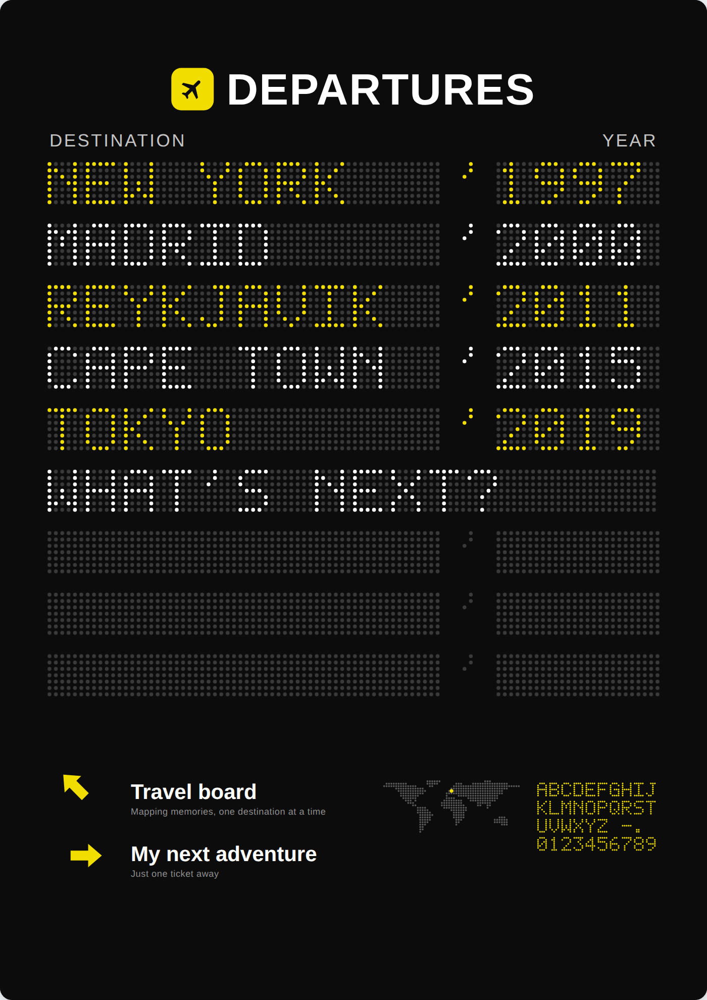

# Smaailcard

*[Nederlandse versie](README.nl.md)*

Custom [Home Assistant](https://www.home-assistant.io/) Lovelace cards in the
style of Smaail's travel posters. This repository ships **two** cards from one
bundle (a single dashboard resource registers both):

- **`custom:smaail-card`**: a **dot-matrix departures board**. Each row is a
  destination with a year, built from individual LED dots, with a world map
  and a character-set legend in the footer.
- **`custom:smaail-world-card`**: a **dot-matrix world map** that lights up
  the countries you have visited, with a progress meter per continent.
  See [World map card](#world-map-card).

Both cards are vector SVG, so they stay sharp at any size, and everything you
see is configurable, either in the visual editor in Home Assistant or in YAML.

<!-- Absolute URL, niet relatief: HACS/Marketplace strijkt relatieve image-paden uit de
     README weg, waardoor het plaatje daar niet laadt. -->


## Installation

[](https://my.home-assistant.io/redirect/hacs_repository/?owner=timoverwoest&repository=smaailcard&category=plugin)

The button opens Smaailcard in the Marketplace on Home Assistant 2026.11 and
newer, and in HACS on older versions.

### Marketplace (Home Assistant 2026.11 and newer)

1. Go to **Settings** → **Marketplace** and search for **Smaailcard** (or use
   the button above).
2. Open Smaailcard, select **Install** and confirm with **Install**.
3. Reload your browser.

The Marketplace adds the dashboard resource for you. If you manage dashboard
resources in YAML, the install dialog shows the line to add.

### HACS (Home Assistant 2026.10 and older)

1. Open HACS and search for **Smaailcard** (or use the button above).
2. Select **Download**.
3. Reload your browser.

### Manual

1. Copy `dist/smaailcard.js` to `/config/www/smaailcard.js`.
2. Settings → Dashboards → menu (⋮) → **Resources** → add:
   - URL: `/local/smaailcard.js`
   - Type: **JavaScript module**
3. Hard refresh your browser.

Smaailcard is a community project: it is maintained here, not by the Home
Assistant project. Please report problems in this repository's
[issues](https://github.com/timoverwoest/smaailcard/issues).

## Adding the card

From the UI: **Add card** → search for "Smaailcard". The card has a full
visual editor, so YAML is not required. The editor is in English, or in Dutch
when Home Assistant is set to Dutch. It shows the default of every option and
only writes the options you change.

Minimal example:

```yaml
type: custom:smaail-card
rows:
  - dest: NEW YORK
    year: "1997"
  - dest: MADRID
    year: "2000"
  - dest: WHAT'S NEXT?
    year: ""
```

## Rows

Each row on the board is an item in `rows`:

| Option | Meaning |
| --- | --- |
| `dest` | Fixed text for the destination. |
| `year` | Year. **Omitted** = empty year column (the grid stays). **`""`** = the row spans the full width. |
| `color` | `yellow`, `white`, `grey` or a hex code. By default rows alternate (yellow/white). |
| `entity` | Entity whose **state** becomes the destination, instead of `dest`. |
| `attribute` | Use this attribute of `entity` instead of its state. |
| `year_entity` | Entity whose state becomes the year. |
| `year_attribute` | Use this attribute of `year_entity`. |

With `entity` the text comes live from Home Assistant:

```yaml
type: custom:smaail-card
title: NEXT UP
rows:
  - entity: sensor.next_trip   # state becomes the destination
    year_entity: sensor.trip_year
  - dest: TEXEL
    year: "2025"
```

The card only redraws when an entity that is actually on the board changes,
not on every state change in HA.

### Order

The card sorts the rows by year itself, so you don't need to put `rows` in
order. By default it sorts ascending (oldest first); `sort: desc` reverses
that, and `sort: none` keeps the order you gave in `rows`.

Rows **without** a year are not sorted: they keep their own order and go below
the sorted rows. That way a closing row such as `WHAT'S NEXT?` stays at the
bottom.

Years that are not numbers (for example `SOON`) are sorted alphabetically and
come after the numeric ones. Rows with the same year keep their order from
`rows`.

The yellow/white alternation follows the order you see on the board, not the
order in the configuration. A row with its own `color` keeps that color, of
course.

The short `"DESTINATION|YEAR"` notation from the original generator script
also works:

```yaml
rows:
  - NEW YORK|1997
  - WHAT'S NEXT?|
```

## All options

| Option | Default | Meaning |
| --- | --- | --- |
| `title` | `DEPARTURES` | Header text. Centered automatically. |
| `dest_label` | `DESTINATION` | Label above the destination column. |
| `year_label` | `YEAR` | Label above the year column. |
| `rows` | `[]` | The rows (see above). |
| `row_count` | `9` (or more if you give more rows) | Number of row slots, including empty ones. |
| `sort` | `asc` | Order: `asc` (by year, oldest first), `desc` (newest first) or `none` (order from `rows`). |
| `show_header` | `true` | Header with airplane icon and title. |
| `show_column_labels` | `true` | Column labels. |
| `show_footer` | `true` | The two footer texts with arrows. |
| `show_map` | `true` | World map in the footer. |
| `show_legend` | `true` | Character-set legend in the footer. |
| `pin` | `[5.12, 52.09]` | Marker on the world map as `[longitude, latitude]`. `null` hides it. |
| `footer_title` | `Travel board` | First footer text. |
| `footer_subtitle` | `Mapping memories, one destination at a time` | Its subtitle. |
| `footer2_title` | `My next adventure` | Second footer text. |
| `footer2_subtitle` | `Just one ticket away` | Its subtitle. |
| `accent_color` | `#F2DD00` | Accent color (icon, arrows, legend, marker). |
| `background_color` | `#0C0C0C` | Board background. |
| `unlit_color` | `#3A3A3A` | Color of the unlit dots. |

If you turn sections off, the card shrinks with them: the space a hidden block
would take is removed, so no empty area is left. With all sections on and
`row_count: 9` the card has exactly the original poster ratio (1000×1414).

A compact variant, for example next to other cards:

```yaml
type: custom:smaail-card
title: LOGBOOK
row_count: 4
show_map: false
show_legend: false
show_footer: false
rows:
  - dest: TEXEL
    year: "2024"
  - dest: VLIELAND
    year: "2025"
```

## Character set

The board uses a 5×7 dot-matrix font with a limited character set:

```
A-Z   0-9   space   -   .   ?   '
```

Text is converted to upper case and cut off at what fits: **10 characters** in
the destination column, **4** in the year column, and **16** on a full-width
row.

Before drawing, characters outside that set are brought back, as far as
possible, to something the board can show:

- **Smart punctuation** is straightened. Phones and Macs quietly replace a
  typed `'` with a typographic `’`; that becomes a plain apostrophe again. The
  same goes for en and em dashes (`–`, `—`) and the ellipsis (`…`).
- **Accents are stripped**: `MÁLAGA` → `MALAGA`, `ZÜRICH` → `ZURICH`,
  `REYKJAVÍK` → `REYKJAVIK`.
- **Letters that Unicode does not decompose** are spelled out:
  `TROMSØ` → `TROMSO`, `ÆRØ` → `AERO`, `ÞINGVELLIR` → `THINGVELLIR`.

Anything still outside the character set after that is drawn as a space.

## World map card

`custom:smaail-world-card` draws a dotted world map on which the countries you
have visited light up in the accent color, with a progress meter per continent
at the bottom (North America … Oceania) and a small overview map. Add the card
with **Add card** → search for "Smaail World Map"; it has a full visual editor
too.

Minimal example, listing the visited countries:

```yaml
type: custom:smaail-world-card
countries:
  - NL
  - BE
  - FR
  - Spain          # a name works too
  - USA            # and so does an alias
  - JP
  - AU
```

A country can be an **ISO code** (`NL`, `FR`), **ISO-3** (`NLD`), **English
name** (`Netherlands`) or a known **alias** (`USA`, `UK`, `UAE`, `South Korea`,
…). Each recognized country fills its land mass; the meters count per
continent how many countries you have visited.

Live from Home Assistant, with an entity that provides a list (a JSON array or
a list separated by commas/newlines); it is merged with an optional fixed
`countries` list:

```yaml
type: custom:smaail-world-card
countries_entity: sensor.visited_countries   # state = "NL, BE, MA, JP, ..."
# countries_attribute: country_codes          # or an attribute instead of the state
```

The card only redraws when that entity actually changes.

### All options (world map)

| Option | Default | Meaning |
| --- | --- | --- |
| `title` | `WORLD MAP` | Header text. Centered automatically. |
| `countries` | `[]` | Visited countries (see above). |
| `countries_entity` | — | Entity whose state/attribute provides the country list. |
| `countries_attribute` | — | Attribute of `countries_entity` instead of the state. |
| `show_header` | `true` | Header with globe icon and title. |
| `show_stats` | `true` | "N countries · M/6 continents" line below the title. |
| `show_meters` | `true` | Progress meters per continent. |
| `show_overview` | `true` | Small overview map between the meters. |
| `caption` | `""` | Caption below the overview map (empty = none). |
| `accent_color` | `#F2DD00` | Accent color (visited countries, icon, counts). |
| `background_color` | `#0C0C0C` | Background. |
| `land_color` | `#3A3A3A` | Color of land you have not visited (yet). |

The map geometry comes from [Natural Earth](https://www.naturalearthdata.com/)
110m country borders, rasterized onto a dot grid with
[`tools/gen_worldmap.py`](tools/gen_worldmap.py) (see
[`tools/README.md`](tools/README.md)). On this fairly coarse grid some of the
smallest countries get a single representative dot; very small island states
may be missing.

## Development

```bash
npm install
npm run dev      # card in the browser with a mock hass, no Home Assistant needed
npm run build    # type check + dist/smaailcard.js
npm run typecheck
npm test         # tests for what the cards calculate (needs Vitest, see below)
```

`npm run dev` serves `index.html` with a mocked `hass` object, so you can work
on the card live without a running Home Assistant. The mock data is in
`src/dev.ts`.

### Code style

The code follows the
[coding guidelines of the Home Assistant frontend](https://contributors.home-assistant.io/frontend/development/guidelines/)
and the pages on [custom cards](https://contributors.home-assistant.io/frontend/custom-ui/card/),
with the same Prettier and ESLint setup as the frontend (`.prettierrc.json`,
`eslint.config.mjs`, rules in `eslint-ha.json`). The Build workflow checks both
on every push. To run the check yourself, install the tools without changing
`package.json` (the versions the frontend uses):

```bash
npm install --no-save --no-package-lock prettier@3.10.1 eslint@10.15.0 \
  @eslint/js@10.0.1 globals@17.14.0 typescript-eslint@8.73.0 \
  eslint-config-prettier@10.1.8 eslint-plugin-lit@2.3.1 \
  eslint-plugin-lit-a11y@5.1.3 eslint-plugin-wc@3.1.0 \
  eslint-plugin-import-x@4.18.1 eslint-plugin-unused-imports@4.4.1 \
  @html-eslint/eslint-plugin@0.68.0
npm run format:check
npm run lint
```

The tests use Vitest, as the frontend does, also installed without changing
`package.json`. Vitest 5 needs Vite 6.4 or newer, so install that next to it:

```bash
npm install --no-save --no-package-lock vitest@5.1.1 vite@8.3.8
npm test
```

Formatting-only commits are listed in `.git-blame-ignore-revs`; run
`git config blame.ignoreRevsFile .git-blame-ignore-revs` to skip them in
`git blame`.

### Project structure

| Path | Purpose |
| --- | --- |
| `src/smaailcard.ts` | Departures board card (`<smaail-card>`) + bundle entry (also imports the world map card). |
| `src/editor.ts` | Visual config editor (`<smaail-card-editor>`). |
| `src/board.ts` | Builds the departures board SVG: geometry, rows, footer, map, legend. |
| `src/worldcard.ts` | World map card (`<smaail-world-card>`): config, entity, layout. |
| `src/worldeditor.ts` | Visual config editor (`<smaail-world-card-editor>`). |
| `src/worldboard.ts` | Builds the world map SVG: map, meters, overview map. |
| `src/worldmapdata.ts` | Generated: per-country dot grid + country/continent table. |
| `src/countries.ts` | Country matching (ISO/name/alias) and resolving the visited set. |
| `src/font.ts` | The 5×7 dot-matrix font. |
| `src/dots.ts` | Dot and text primitives. |
| `src/worldmap.ts` | Continent outlines + projection for the mini world map (departures board). |
| `src/types.ts` | Configuration types. |
| `src/defaults.ts` | Defaults shared by the cards and their editors. |
| `src/localize.ts` | Editor texts in English and Dutch. |
| `test/` | Tests for what the cards calculate (Vitest). |
| `src/dev.ts`, `index.html` | Browser dev harness (shows both cards). |
| `tools/gen_worldmap.py` | Regenerates `src/worldmapdata.ts` from Natural Earth (see `tools/README.md`). |

The geometry (grid spacing, column widths, colors, the font and the continent
outlines) is taken from the original `departures_board.py` generator script,
so with `row_count: 9` the card gives exactly the same image as the poster.

Where the card deliberately differs from that script:

- **Performance.** The script draws every dot as a separate `<circle>` (~5500
  of them). Because a Lovelace card redraws on every state change, the card
  uses one SVG `pattern` for the unlit grid and groups the lit dots per color
  into one `<path>`: ~60 DOM nodes instead of ~5500.
- **Header centering.** The script places the header at a fixed position that
  only works for the word "DEPARTURES". The card measures the header after
  drawing and centers it, so any `title` lines up.
- **Truncation.** Text that is too long is cut off at what fits in the column,
  so a destination never runs into the year column.

## Credits

The board design is based on a poster by
**[Smaail](https://smaail.be/index.php/posters/)**. The dot-matrix font, the
grid geometry, the color palette and the mini world map are taken from the
`departures_board.py` generator script that recreates that design.

This is a personal Home Assistant project, not published by or affiliated with
Smaail. The rights to the original poster design belong to Smaail; the MIT
license below applies to the code in this repository.

## License

[MIT](LICENSE)
